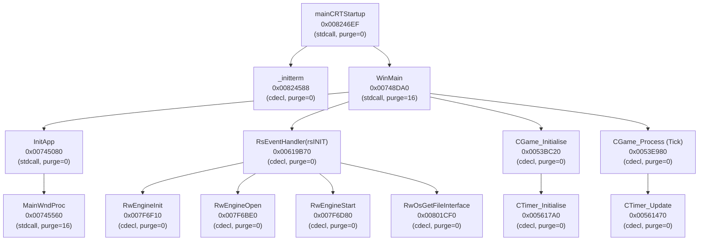

# Investigation 0002: Startup Call Graph & Subsystem Frontiers

> Documentation review (2026-09-19): **HISTORICAL**. Retain the startup and ABI hypotheses for rechecking. Old symbol addresses, game-state meanings and milestone numbering are not current authority.
> Evidence status: **UNKNOWN for present-day claims** unless independently revalidated.
> See the [documentation review](../documentation-review.md) and [current runtime architecture](../runtime-architecture.md).

## Overview

- **Investigation Date**: 2026-09-13
- **Executable Revision**: `gta_sa_compact` (v1.0 US Clean / Unpacked)
- **Phase Gate**: Milestone M2 (Analysis & Function Discovery)
- **Objective**: Establish complete executable memory layout, verify x86 calling conventions, and map the active startup execution slice.

---

## 1. Executable Memory Layout & Protection Regions

From PE header analysis and address mapping, the 32-bit guest address space (`0x00400000` base) is segmented into the following verified regions:

| Region | Start VA | End VA | Virtual Size | Protection | Purpose |
|---|---|---|---|---|---|
| `.text` | `0x00401000` | `0x00856CDA` | 4,545,754 bytes | `RX` | Primary game executable code |
| `_rwcseg` | `0x00857000` | `0x00857451` | 1,105 bytes | `RX` | RenderWare auxiliary code segment |
| `.rdata` | `0x00858000` | `0x008A329C` | 307,868 bytes | `R` | Read-only data, string literals, vtables, jump tables |
| `.data` | `0x008A4000` | `0x008E4000` | 262,144 bytes | `RW` | Initialized global variables & function pointers |
| `bss` | `0x008E4000` | `0x00C9D434` | 3,904,564 bytes | `RW` | Uninitialized static buffers, pools, and subsystem state |

---

## 2. Active Startup Execution Slice & Call Graph

The startup path proceeds deterministically from the PE entry point through the C runtime, Windows shell, RenderWare engine bootstrap, and into the main GTA game loop:

---

## 3. ABI & Calling Convention Verification

### Callee vs Caller Stack Cleanup

1. **`WinMain` (`0x00748DA0`)**:
   - Signature: `int WINAPI WinMain(HINSTANCE hInstance, HINSTANCE hPrevInstance, LPSTR lpCmdLine, int nCmdShow)`
   - Disassembly epilogue ends with: `ret 0x10` (16 bytes).
   - Invariant: `stdcall`, callee purges 16 bytes. If called via `cdecl` by recompilation dispatch, the caller would double-pop or desync the stack frame, resulting in an immediate crash upon return.
2. **`MainWndProc` (`0x00745560`)**:
   - Signature: `LRESULT CALLBACK MainWndProc(HWND hwnd, UINT uMsg, WPARAM wParam, LPARAM lParam)`
   - Disassembly epilogue ends with: `ret 0x10` (16 bytes).
   - Invariant: `stdcall`, callee purges 16 bytes.
3. **RenderWare Functions (`RwEngine*`, `RsEventHandler`)**:
   - Disassembly epilogues end with plain `ret`.
   - Call sites clean the stack with `add esp, N`.
   - Invariant: `cdecl`, caller purges stack, `stack_purge = 0`.
4. **Game Subsystem Methods (`CGame_*`, `CTimer_*`)**:
   - Disassembly epilogues end with plain `ret`.
   - Invariant: `cdecl`, `stack_purge = 0`.

---

## 4. Key Engine Globals

| Name | Address | Size | Type | Purpose |
|---|---|---|---|---|
| `RsGlobal` | `0x00C17040` | 36 | `RsGlobalType` | Application window dimensions, title, frame limit flag, quit flag |
| `RwEngineInstance` | `0x00C97B24` | 4 | `RwGlobals*` | RenderWare core engine state and device driver dispatch |
| `g_gameState` | `0x00C8D4C0` | 4 | `uint32_t` | GTA engine state (0: initializing, 1: running, 2: frontend menu) |
| `CTimer::m_snTimeInMilliseconds` | `0x00B7CB84` | 4 | `uint32_t` | Global game simulation time clock |
| `CTimer::ms_fTimeStep` | `0x00B7CB5C` | 4 | `float` | Simulation tick delta multiplier (nominally 1.0 @ 30 FPS) |
| `Scene` | `0x00C17038` | 8 | `Scene` | RenderWare default world camera and scene container |

---

## 5. Milestone M2 Verification Summary

- Automated validation via `scripts/analysis/analyze_startup.py` passed with 0 errors.
- All 18 discovered functions reside inside verified executable sections.
- Reachable startup execution slice mapped from entry point to main game loop.
- Ready to proceed to **Milestone M3 (Targeted Function Lifting & Codegen)**.
