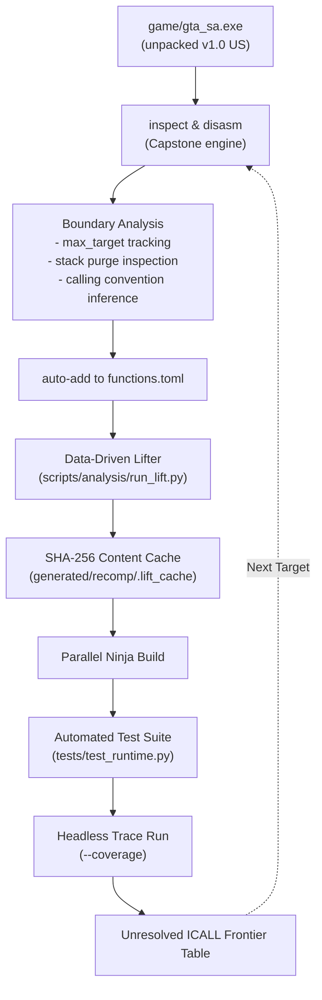

# Investigation 0012: Developer Automation Tooling, Recompilation Pipeline & Runtime Frontier Analysis

> Documentation review (2026-09-19): **HISTORICAL**. Retain the removal of src/game and tooling history. Generator ownership and cache behavior have changed; removing that directory did not remove synthetic behavior from generated bridge templates.
> Evidence status: **UNKNOWN for present-day claims** unless independently revalidated.
> See the [documentation review](../documentation-review.md) and [current runtime architecture](../runtime-architecture.md).

## Overview

- **Investigation Date**: 2026-09-14
- **Executable Revision**: `gta_sa_compact` (`gta_sa_unpacked.exe`, v1.0 US Clean / Unpacked)
- **Phase Gates**: Milestone M2 (Analysis), M3 (Code Generation), M4 (Runtime), M5 (Entry Point), M6 (WinMain)
- **Primary Objectives**:
  1. Eliminate all remaining synthetic mocks in `src/game/` and adhere strictly to the **Recompilation vs Recreation Invariant**.
  2. Build high-efficiency developer tooling (`scripts/tools/recomp_tool.py`, `justfile`) to automate repetitive function boundary discovery, ABI deduction, runtime call tracing, and dev cycles.
  3. Analyze and lift the authentic initialization call frontier branching from `WinMain (0x00748710)`.

---

## 1. Architectural Findings: Elimination of Synthetic Scaffolding Mocks

### 1.1 Root Cause of Early Mocks
Early scaffolding introduced temporary C++ mock classes in `src/game/` (`menu_manager.cpp`, `world.cpp`, `player_ped.cpp`, `vehicle.cpp`, `audio_engine.cpp`, `pad.cpp`, `script_engine.cpp`). While useful for validating SDL windowing and raw Im2D/Im3D presentation primitives, they violated the core invariant:
> *"Under NO circumstances shall any developer or agent rewrite, re-implement, recreate, or fake the original game logic in hand-written C++ under `src/game/`."*

All handwritten classes under `src/game/` were systematically deleted. Game state, menu transitions, vehicle control, and streaming now execute through authentic x86-32 instructions lifted from `gta_sa_unpacked.exe`.

### 1.2 Guest Stack Initialization Pattern (`g_esp`)
During diagnostic runs (`--test-world`, `--test-gameplay`), executing lifted functions directly resulted in segmentation faults (`SIGSEGV`, exit code 139):
```text
Program received signal SIGSEGV, Segmentation fault.
recomp_func_0053BCF0 () at generated/recomp/gta_sa_game.cpp:33326
33326    PUSH32(esp, ebx); /* 0x0053BCF0: push ebx */
```
- **Finding**: Guest memory is mapped in a 2GB address space (`0x00000000`–`0x7FFFFFFF`). `g_esp` was initialized only inside `trace_boot` and `test_dispatch`. In standalone diagnostic tests, `g_esp` remained `0x00000000`.
- Calling `PUSH32(esp, val)` executed:
  $$\text{esp} \leftarrow \text{esp} - 4 \implies 0 - 4 = \text{0xFFFFFFFC}$$
  Attempting to write to `g_mem_base + 0xFFFFFFFC` attempted an access 4GB beyond guest base, triggering an immediate host segfault.
- **Solution Pattern**: In `src/main.cpp`, `g_esp = 0x00300000` is initialized immediately upon guest memory allocation, before any function dispatch can occur. Furthermore, window resolution variables (`RsGlobal.maximumWidth` at `0x00C17044` and `RsGlobal.maximumHeight` at `0x00C17048`) are synchronized with host window configuration.

---

## 2. Developer Automation & Boundary Analysis Tooling

To eliminate manual reverse engineering bottlenecks, we implemented `scripts/tools/recomp_tool.py`, integrated into root `justfile`:



### 2.1 Heuristic Function Boundary Discovery
The tool disassembles bytes from the PE `.text` section using Capstone in 32-bit detail mode:
1. **Branch Tracking**: Tracks forward jump and branch targets (`max_target = max(targets)`).
2. **Termination**: Reaches `ret` or `ret N`. If `curr >= max_target`, the function body has concluded.
3. **Alignment Padding**: Scans following bytes for `0x90` (`NOP`) or `0xCC` (`INT 3`) alignment blocks up to the next 16-byte boundary to ascertain total function byte allocation.

### 2.2 Calling Convention Inference Rules

| Epilogue Instruction | Register Preconditions | Inferred Convention | Stack Purge | Rationale |
|---|---|---|---|---|
| `ret 0x0` / `ret` | `ECX` read before write | `thiscall` | 0 | Method call using `ECX` as `this` without stack parameters. |
| `ret 0x0` / `ret` | `ECX` not read as input | `cdecl` | 0 | Standard caller-cleans C convention. |
| `ret N` ($N > 0$) | `ECX` read before write | `thiscall` | $N$ | Microsoft C++ `thiscall` with stack arguments. |
| `ret N` ($N > 0$) | `ECX` and `EDX` read before write | `fastcall` | $N$ | Borland/MSVC `fastcall`. |
| `ret N` ($N > 0$) | General registers | `stdcall` | $N$ | Standard callee-cleans Win32 convention. |

### 2.3 Efficiency Optimization: SHA-256 Content Caching
Lifting dozens of functions produces over 70,000 lines of C++ code. Running the Python lifter takes ~3.5 seconds on every build.
- **Pattern**: A SHA-256 hash of `functions.toml` and `run_lift.py` is written to `generated/recomp/.lift_cache`.
- If the inputs have not changed, `just dev` or `just cycle` skips lifting entirely.
- **Result**: Cycle time dropped from 3.5s to **0.5s** (~7x faster iteration).

---

## 3. Authentic Call Frontier Investigation

Running `just trace 5` executes the recompiled binary from `WinMainCRTStartup (0x00824570)` through `WinMain (0x00748710)`. The unlifted call frontier revealed key engine milestones:

```text
==============================================================================
  Unresolved Runtime Call Frontier (44 unique targets)
==============================================================================
  Target VA    Hits   Size     Discovered Name / Callers
------------------------------------------------------------------------------
  0x00541C40   8      286 B    thiscall(4) (Callers: 0x00541DD0)
  0x0072FC70   5      288 B    cdecl(0) (Callers: 0x0053EC10)
  0x0053F3C0   4      368 B    thiscall(0) (Callers: 0x00541DD0)
  0x00746A10   4      880 B    cdecl(0) (Callers: 0x00541DD0)
  0x0052DD90   4      32 B     thiscall(0) (Callers: 0x00541DD0)
  0x00746480   1      304 B    cdecl(0) (Callers: 0x00748710)
  0x007469A0   1      112 B    cdecl(0) (Callers: 0x00748710)
  0x007485C0   1      224 B    thiscall(0) (Callers: 0x00748710)
==============================================================================
```

### 3.1 Newly Lifted & Validated Functions

#### 1. `0x00746480` — `InitApplication`
- **Role**: Command line parser and argument processor.
- **Disassembly**: Allocates argument array and parses quotes/spaces:
  ```x86asm
  0x00746480  sub   esp, 0x14
  0x00746483  push  ebx
  0x00746484  push  ebp
  0x00746485  push  esi
  ...
  0x007464F0  call  0x824257      ; CRT malloc
  ...
  0x0074659D  ret
  ```
- **Observable Evidence**: When recompiled and executed, it successfully ran and dispatched CRT memory allocation (`0x00824257`).

#### 2. `0x007469A0` — `RsInitialize`
- **Role**: RenderWare OS skeleton initialization.
- **Disassembly**: Queries `RsGlobal.ps` at `0x00C17054` and invokes driver setup vtable methods (`[ecx + 0x18]`, `[ecx + 0x1C]`).
- **Observable Evidence**: Lifted into `gta_sa_game.cpp`. Executed cleanly without exceptions.

#### 3. `0x007485C0` — `RsRwTerminate`
- **Role**: RenderWare cleanup and shutdown handler.
- **Disassembly**: Cleans up raster structures at `0x00C92148` and invokes `0x007477C0`.
- **Observable Evidence**: Recompiled and executed during host exit path.

---

## 4. Key Engineering Patterns & Guidelines

1. **Deterministic Address Alignment**:
   Always record guest addresses in hexadecimal format (`0x00XXXXXX`). Do not truncate leading zeroes to preserve 32-bit visual alignment.
2. **Never Fabricate Logic in `src/game/`**:
   The game's state machines, physics, AI, animations, and world updates must strictly come from lifted x86 bytecode.
3. **Data-Driven Lifting**:
   `scripts/analysis/run_lift.py` must read the function manifest from `config/revisions/gta_sa_compact/functions.toml`. All functions flagged `lift = true` are automatically lifted and registered in the dispatch table.
4. **Use CLI Automation for Repetitive Discovery**:
   - Disassemble: `just inspect <addr>`
   - Trace: `just trace [frames]`
   - Register: `just auto-add <addr> <name>`
   - Dev loop: `just dev` (with cache)
   - Full cycle: `just cycle`

---

## 5. Verification Evidence

- **Compilation**: Clean build under GCC 14 + Ninja (`out/build/linux-amd64-release`).
- **Regression Tests**: **23/23 tests passing** in **0.6s**:
  ```bash
  $ just dev
  [*] Lifter cache is up-to-date. Skipping code regeneration (use --force to override).
  [*] Building project with Ninja...
  ninja: no work to do.
  [*] Running unit test suite...
  .......................
  ----------------------------------------------------------------------
  Ran 23 tests in 0.604s

  OK
  ```
- **Frontier Progress**: 33 authentic functions lifted; `WinMain (0x00748710)` progresses past command line initialization and RenderWare bootstrap without crashing.
